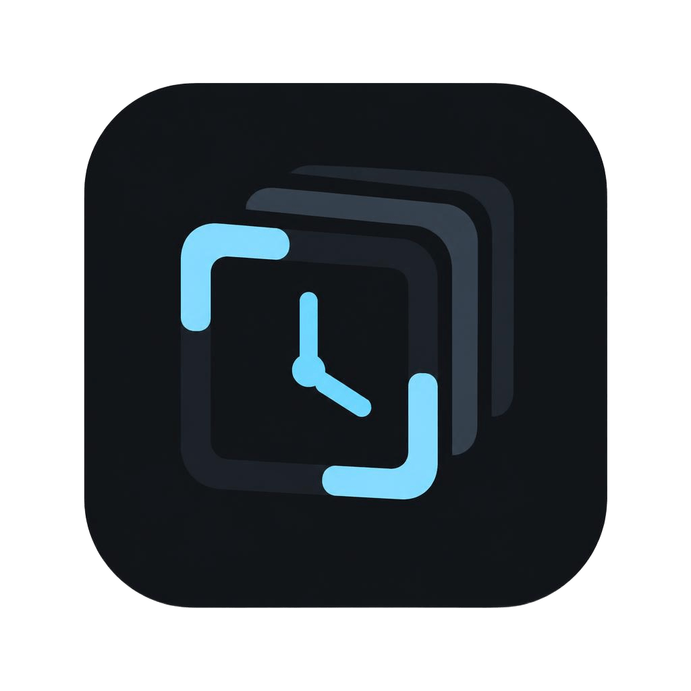
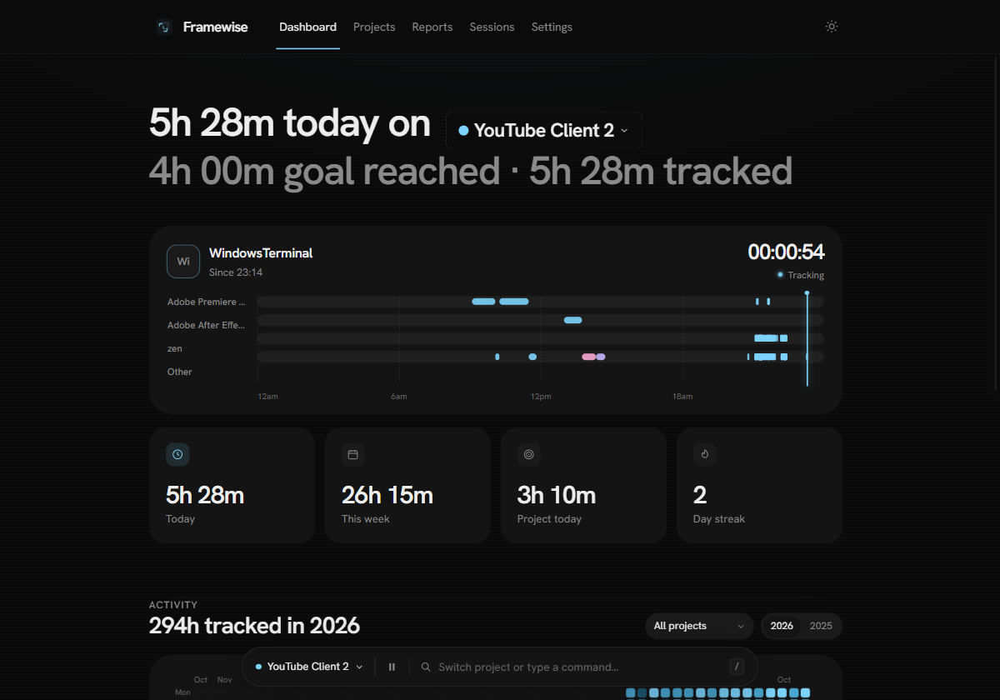
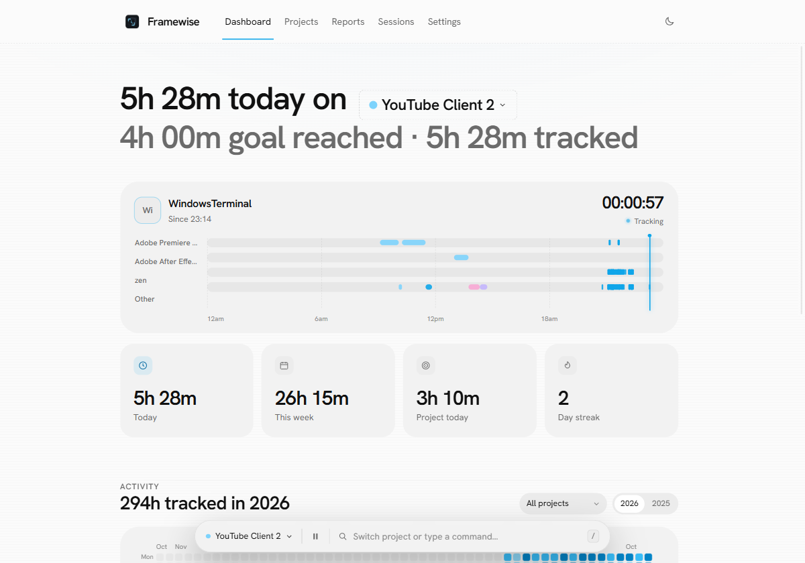
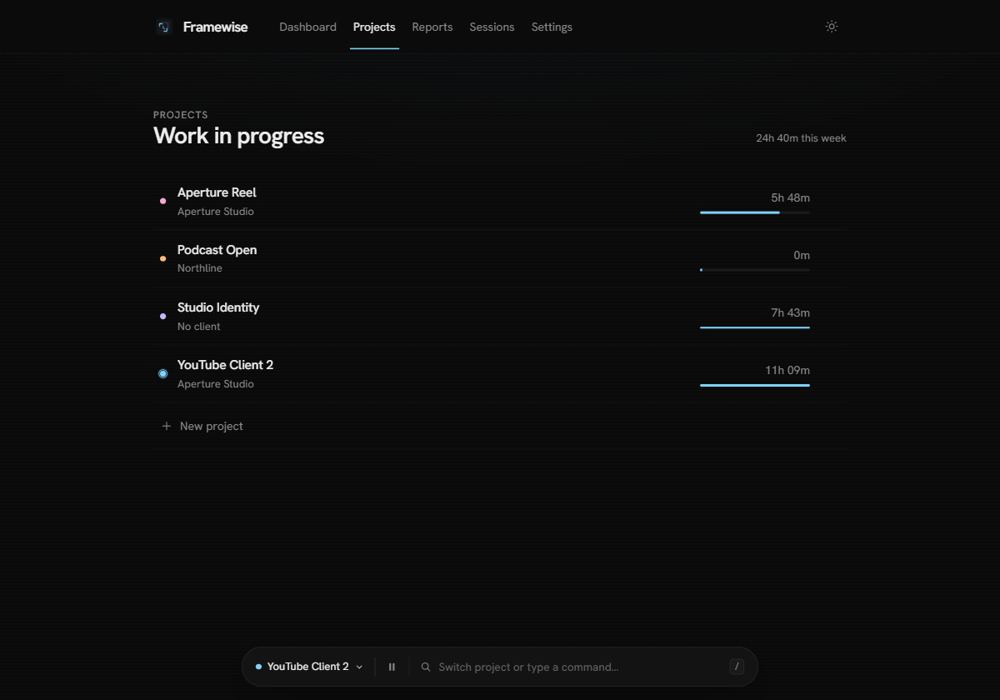
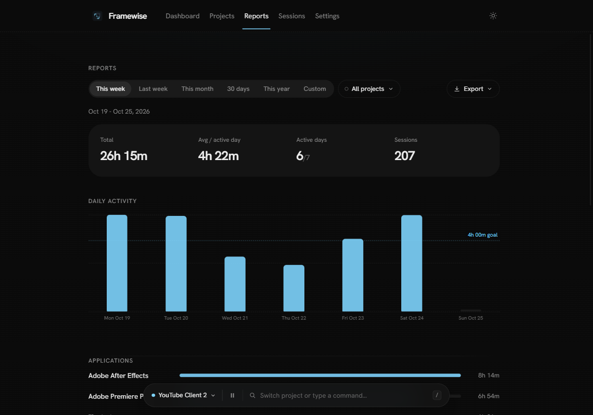
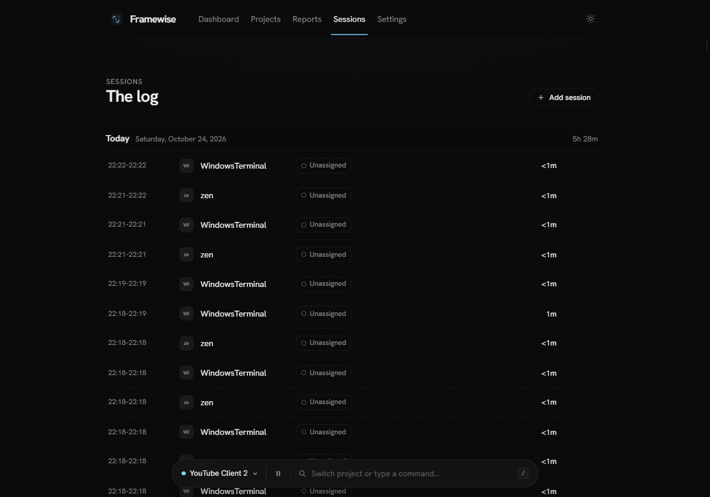
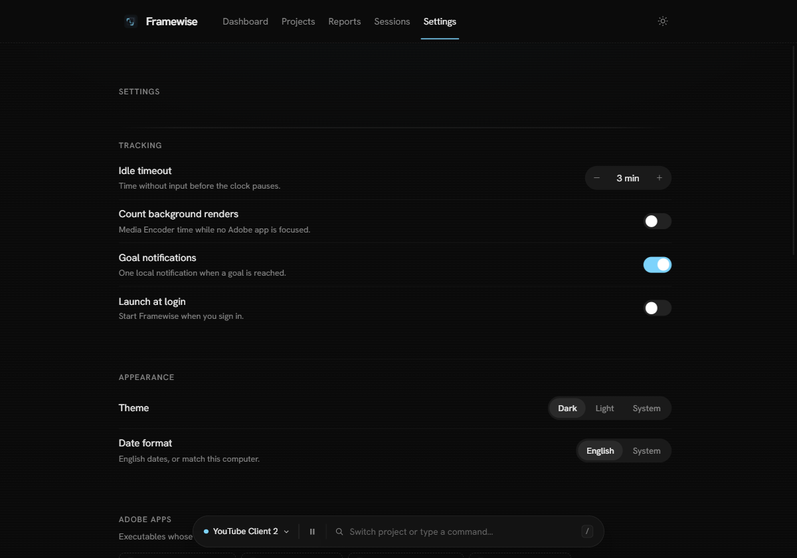
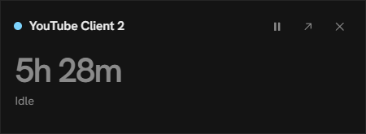

<p align="center">
  
</p>

<h1 align="center">Framewise</h1>

<p align="center">
  <strong>A quiet, offline time tracker for Adobe creatives.</strong><br />
  Coming soon for Windows 10/11 &nbsp;·&nbsp; Offline by design &nbsp;·&nbsp; MIT
</p>

<p align="center">
  
</p>

Framewise follows the app in focus and credits Premiere, After Effects and Photoshop
time to the project you are actually on. It lives in the tray, keeps every number on
your machine, and stays out of the edit.

- **Adobe-first attribution.** Adobe apps get the active project. Everything else is
  tracked for general stats without a project. No project selected means unassigned,
  never guessed.
- **One live sentence.** Today's time, the current project and the goal you are
  working toward, in one quiet header. No dashboard noise.
- **A real 24-hour view.** App tracks, session pills and a now cursor, so the day is
  legible at a glance.
- **Goals, heatmap, reports.** Daily and weekly rings, a year contribution map, six
  report ranges, and CSV / JSON / Markdown export.
- **Portable and private.** One folder, no installer, no network requests, no
  accounts, no telemetry, no remote fonts.
- **A tray that behaves.** Single click opens a mini timer near the tray; double
  click opens the full app.

## Screenshots

<p align="center">
  
  
</p>

<p align="center">
  
  
</p>

<p align="center">
  
  
</p>

## The details

**Tracking.** The foreground executable is sampled every 1.5 seconds and stored as
local sessions. Sessions split at local midnight and at every app or project switch.

**Pausing.** Idle, lock, sleep and hibernation stop the clock. Idle time is cut back
to the last real input, so idle minutes are never billed. A sleep gap is never
bridged with phantom time.

**Goals.** A new install starts with **no goals** — no surprise 4-hour target. Create
daily or weekly goals from the dashboard; the rings grow on first view only and the
value can be edited inline.

**Projects.** Name, client, color, archive, delete (confirm only for delete), active
project, per-project stats. A project detail page has per-app bars, a 30-day chart
and a six-month mini heatmap.

**Reports.** This week, last week, this month, 30 days, this year, or a custom range.
A single project filter and a single export menu. Goal line inside the chart, no
overlapping labels.

**Sessions.** Grouped by day with sticky headings. Reassign a session's project
inline, edit or delete on hover, or add a manual session from the dock.

**Settings.** Autosaving rows, a stepper for idle timeout, segmented theme and date
format controls, and native `.exe` pickers for the Adobe and ignore lists.

**Theme.** Dark and light, with a circular reveal from the top-right corner. Motion
is transform/opacity only and respects `prefers-reduced-motion`.

## Portable build

The deliverable is a folder, not an installer or an archive:

```
release/Framewise_1.0.0_x64_portable/
├── framewise.exe
├── framewise.portable
└── README.txt
```

Run `framewise.exe` from that folder. Everything stays beside it:

```
data/framewise.sqlite3   sessions, projects and settings
data/webview/            the WebView2 profile and cache
```

Nothing is written to AppData or LocalAppData. Launch at login is disabled. Delete
the folder to remove every trace. Settings → About reports whether the running build
is installed or portable, with the active data path.

Build it with:

```bash
npm run build:portable
```

This produces the folder above. There is no zip.

## Offline and privacy

Framewise makes no network requests. No telemetry, accounts, remote fonts or CDN
assets. The content security policy allows only the app's own files and the Tauri IPC
bridge. The database is a single SQLite file in WAL mode with a 15-second flush and a
checkpoint on quit.

## Keyboard

| Shortcut | Action |
| --- | --- |
| `/` or `Ctrl+K` | Open the dock / project switcher |
| `1` … `5` | Dashboard, Projects, Reports, Sessions, Settings |
| `↑` `↓` | Move through dock results |
| `Enter` | Run the selected command |
| `Esc` | Close the dock or a dialog |

## Development

Requirements: Windows 10/11, Node.js 20+, Rust with the MSVC toolchain, WebView2.

```bash
npm install
npm run tauri dev
```

Checks:

```bash
npm run check          # svelte-check / TypeScript / a11y
npm run build          # Vite production build
npm run audit:offline  # fails on any remote asset or endpoint
cargo test --lib       # 26 backend tests
cargo check            # backend type check
```

Run the cargo commands from `src-tauri/`.

## Tests

The backend keeps 26 unit tests covering midnight splitting, multi-day intervals,
idle cutoff, sleep gap detection, Adobe attribution, ignored apps, goal progress and
streaks, report grouping, CSV escaping and reassignment.

## License

MIT. See [LICENSE](LICENSE). Copyright © 2026 Sneg HQ.
